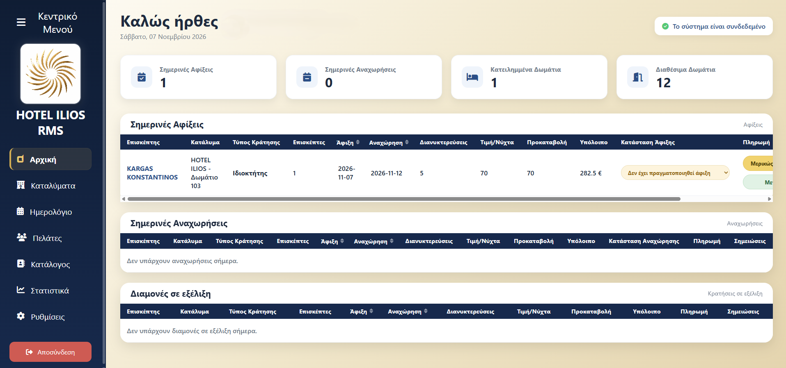
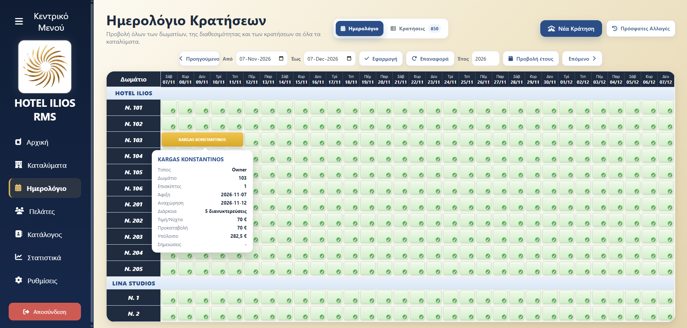
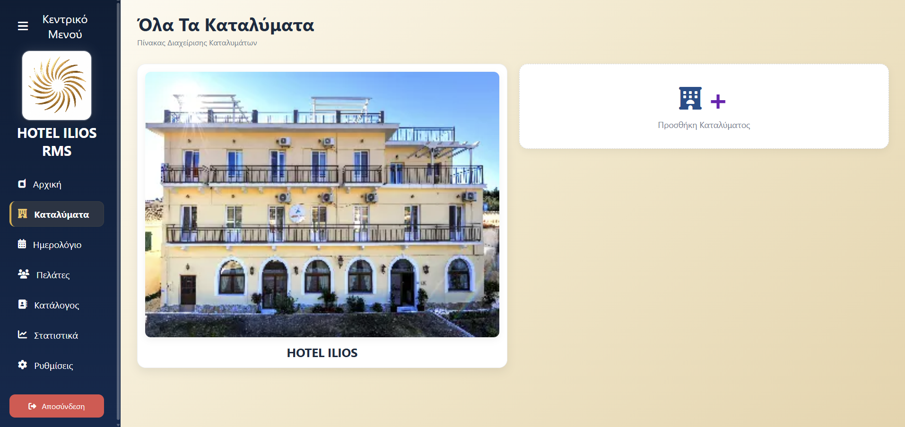
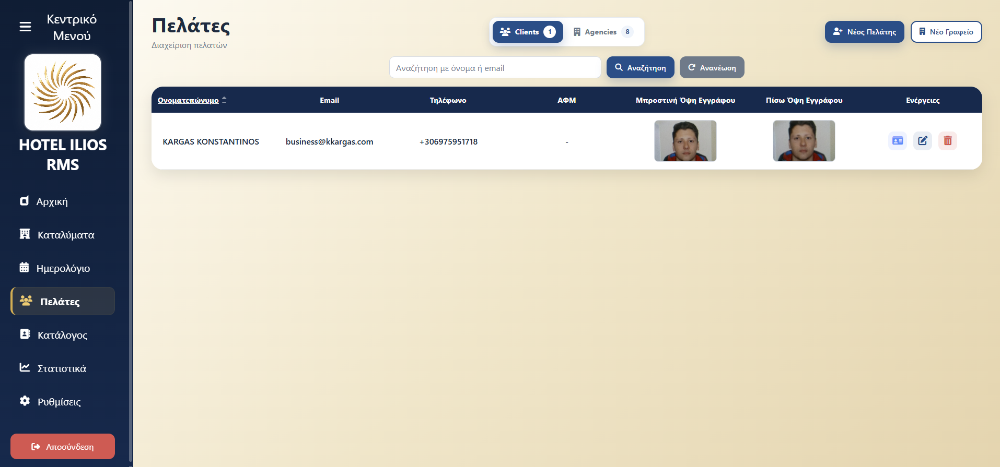
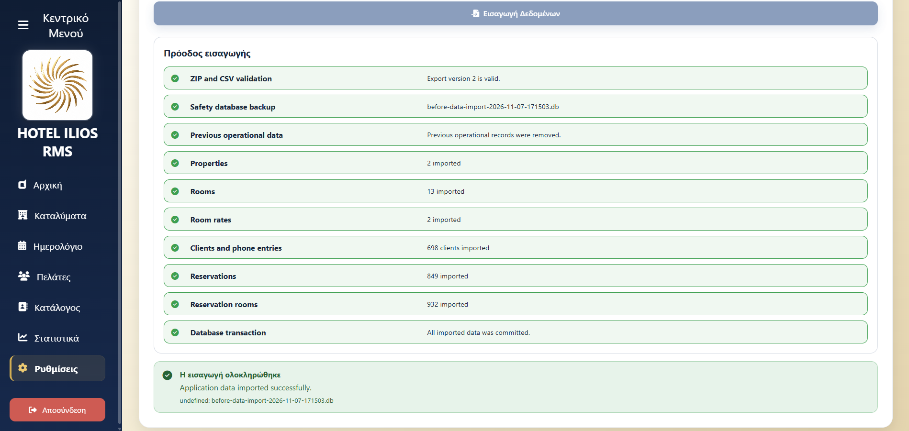
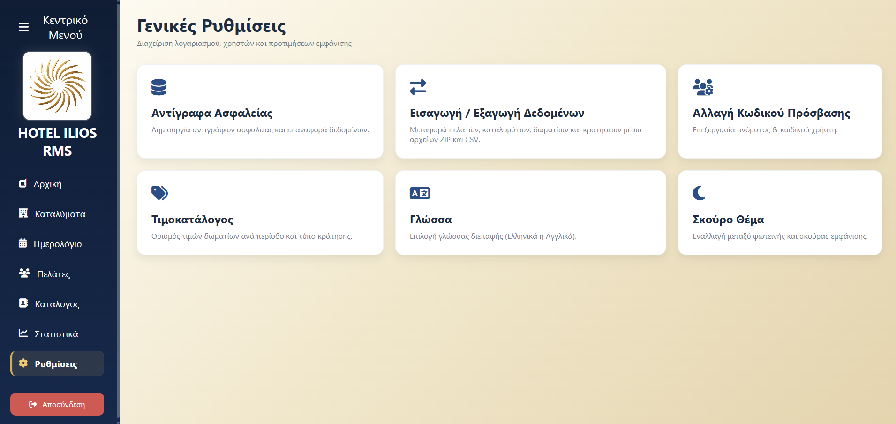

<!-- Add the Hotel Ilios RMS logo to assets/logo.png, then uncomment:

-->

# Hotel Ilios RMS

### Reservation Management System for Hospitality Operations

**A privately developed, production-used platform for hotel reservations, guests, properties, payments, and operational reporting.**

**Hotel Ilios RMS** is a privately developed reservation and property management application built for the day-to-day operations of a small hospitality business in Paxos, Greece.

The system was designed, deployed, and used in a real hospitality environment. It brings reservations, guest records, accommodation information, pricing, payments, and operational reporting into a single, streamlined interface.

> **Private commercial-use project:** This repository is a public portfolio showcase. It intentionally contains documentation only. The application source code, database, guest records, internal business configuration, and production assets are not publicly distributed.

---

## Project Overview

Hotel Ilios RMS began as a practical solution to manage daily hotel operations more efficiently. It evolved through hands-on use and feedback from actual reception and property-management workflows.

The application supports multiple properties and rooms, multi-room reservations, guest management, flexible seasonal pricing, payment tracking, and calendar-based occupancy management. It also includes bilingual navigation and administrative utilities for backup and data transfer.

### Core Features

| Module | Capabilities |
| --- | --- |
| **Dashboard** | Today's arrivals, departures, and in-house guests; reservation and payment information; quick operational updates |
| **Reservations** | Create, edit, and manage multi-room reservations, per-room dates and guest counts, notes, deposits, payment details, and booking references |
| **Interactive Calendar** | Room-by-room availability, color-coded reservations, date-range navigation, hover information, and yearly views |
| **Properties & Rooms** | Manage multiple properties, rooms, capacity, room categories, views, amenities, and photos |
| **Guest & Agency Management** | Guest profiles, contact details, identification-document references, and agency-linked reservations |
| **Pricing & Taxes** | Seasonal room rates, per-room pricing, manually adjustable reservation totals, and configurable accommodation tax by property and period |
| **Payments** | Deposits, deposit destination, payment method, payment status, and remaining balances |
| **Directory** | Contact directory with telephone and messaging shortcuts |
| **Statistics** | Occupancy-related summaries, revenue visualizations, and monthly revenue comparisons across years |
| **Data Management** | CSV/ZIP data import and export, database backups, and supporting administrative tools |

### Selected Capabilities

- **Multilingual interface:** Greek and English.
- **Light and dark themes**, with a collapsible navigation sidebar.
- **Search and sorting** across operational tables, including case-insensitive and accent-tolerant matching.
- **Image processing:** WebP handling, resized photographs, and lightweight thumbnails for everyday browsing.
- **Flexible reservation pricing:** different nightly rates within a stay and editable per-room totals.
- **Operational status tracking:** check-in, check-out, and payment states.
- **Role-based access:** administrator and regular user workflows.
- **Desktop deployment:** packaged for macOS using Java's `jpackage` tooling.

---

## Technology Stack

| Layer | Technologies |
| --- | --- |
| Backend | Java 17+, Spring Boot, Spring MVC, Spring Data JPA |
| Security | Spring Security |
| Frontend | Thymeleaf, HTML5, CSS3, JavaScript |
| Data storage | SQLite |
| Build | Maven |
| Charts | Chart.js |
| Packaging | Java `jpackage` (macOS desktop distribution) |

The project follows a server-rendered web application architecture, with a locally hosted interface used through a browser.

---

## Application Screenshots

### Dashboard

### Reservations Calendar

### Property Management

### Client Management

### Data Handling

### Settings

---

## Development & Real-World Use

This project was developed around the needs of **Hotel Ilios** and associated accommodation management workflows in **Paxos, Greece**.

Its design was informed by actual operational use, including seasonal booking volume, agency reservations, reception workflows, accommodation information, guest communications, and end-of-season reviews.

The project demonstrates the design and maintenance of an end-to-end Java application with real data models, business rules, desktop distribution, operational UX, and long-term iteration.

---

## Repository Scope

This repository is **documentation only**.

**Not included:**

- Application source code or build artifacts
- SQLite databases or customer records
- Identity documents, guest photographs, or private uploads
- Credentials, environment settings, internal business files, or proprietary assets

There is no public installer, hosted demo, or source-code license offered through this repository. **All rights reserved.**

---

## Author

**Konstantinos Kargas**  
Full-Stack Software Engineer

- Website: [kkargas.com](https://kkargas.com)
- GitHub: [KonKargas](https://github.com/KonKargas)

---

*Hotel Ilios RMS — designed and developed for practical hospitality management.*
